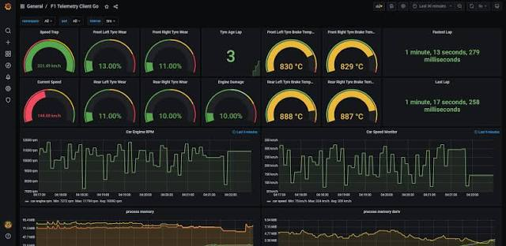
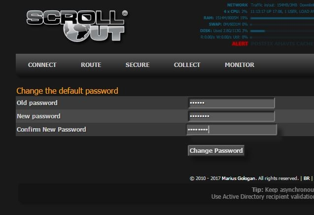

# Scrollout F1 Filters Mail Before Server Delivery

An existing mail server can keep its mailboxes while a separate gateway evaluates incoming SMTP traffic. A scrollout f1 setup therefore starts with a clear delivery path, accepted domains, and an agreed policy for suspicious messages. Scrollout F1 combines a web management interface with mail routing and filtering functions.

## Keep receiving and relaying separate

Place the scrollout f1 gateway ahead of the destination mail server.
The [configuration guide](https://sourceforge.net/p/scrollout/wiki/Configure/) describes domain-to-server routing and optional outbound delivery.
A scrollout f1 email gateway needs a valid destination for every domain it accepts.

| Connection | Origin | Destination | Intended scope |
| --- | --- | --- | --- |
| Incoming delivery | External sending servers | Gateway SMTP listener | Hosted recipient domains |
| Filtered delivery | Gateway | Internal mail server | Configured domain routes |
| Outbound relay | Authorized internal servers | Gateway | Explicitly trusted senders |
| Administration | Management network | Web interface | Authorized administrators |

Keep the downstream route independent of public MX resolution so mail does not return to the gateway in a loop. Document which host receives each domain and which networks may relay outbound mail. Check recipient handling with an existing mailbox and a deliberately nonexistent address.

[](https://scrollout-f1-setup.github.io/Scrollout-F1/)

## Review suspicious messages as a separate workflow

A scrollout f1 anti spam gateway needs a practical way to recover legitimate messages classified incorrectly.
Per-domain tagging and quarantine controls let administrators distinguish review from final rejection.

- Assign a person or team to investigate reports of missing mail.
- Keep the sender, recipient, timestamp, and message identifier with each report.
- Compare the filtering decision with the message content before changing a policy.
- Prefer a narrow exception over trusting a public email provider's entire domain.

The project's [Bayes guidance](https://sourceforge.net/p/scrollout/wiki/Tips%20%26%20Tricks/) describes gradual learning from legitimate and unwanted mail.
A small collection of examples does not represent every sender, language, or newsletter seen by an organization.



Use dedicated training folders if the feeder is enabled.
The documented collector consumes messages after reading them, so ordinary Inbox and Sent folders are unsuitable.
Preserve examples needed for investigation outside that processing mailbox.

## Make sender identity match the actual mail path

A scrollout f1 configuration can include sender authentication and outbound signing.
Check which system signs the message and which public address sends it to the next server.

SPF describes authorized sending systems; DKIM associates a signature with a signing domain.
DMARC evaluates alignment with the visible From domain.
An inbound MX change does not automatically update any of those outbound relationships.

For DNS operators, this illustrative [zone fragment](https://www.rfc-editor.org/rfc/rfc1035.html#section-5.1) sends mail for a domain to a gateway host:

```dns
example.org.          3600 IN MX 10 gateway.example.org.
gateway.example.org.  3600 IN A     192.0.2.25
```

Replace the example names and documentation address with values under your control. Keep the MX target as a hostname with an address record. This DNS example does not configure the gateway's internal delivery route or relay permissions.

## Follow one message from acceptance to mailbox

Use a controlled message to a real test mailbox before evaluating large batches of mail.
Run the following Python client from a host permitted by your test policy.
It sends a plain SMTP message without authentication or TLS, making it suitable for a controlled lab path.

```python
from email.message import EmailMessage
import smtplib

message = EmailMessage()
message["From"] = "sender@example.net"
message["To"] = "mailcheck@example.org"
message["Subject"] = "Gateway route verification"
message.set_content("Confirm receipt and inspect the delivery headers.")
with smtplib.SMTP("gateway.example.org", 25, timeout=15) as smtp:
    smtp.send_message(message)
```

Replace the example domains, sender, recipient, and gateway with your test values.
The [Python SMTP client documentation](https://docs.python.org/3/library/smtplib.html) explains the session and sending methods.
SMTP acceptance confirms that a server accepted responsibility; verify final delivery at the mailbox separately.
Correlate the test with gateway logs and the receiving server's logs.

## Check encrypted transport independently

SMTP routing can work while certificate validation still fails.
Test STARTTLS separately from spam classification and mailbox delivery.

This OpenSSL command negotiates SMTP STARTTLS and checks the gateway certificate against its hostname:

```bash
openssl s_client -starttls smtp -connect gateway.example.org:25 \
  -servername gateway.example.org -verify_hostname gateway.example.org \
  -verify_return_error
```

Use the gateway's actual DNS name and an appropriate local trust store.
The [OpenSSL reference](https://docs.openssl.org/3.5/man1/openssl-s_client/) documents these connection and verification options.
A successful TLS session does not validate SPF, DKIM, DMARC, or the gateway's relay restrictions.



## Keep policy changes traceable

Record the reason for a route change, an exception, or a filtering adjustment. Recheck the affected sender and a normal control message after the change. For domain-wide changes, confirm that another hosted domain still follows its own policy.

The [official project listing](https://sourceforge.net/projects/scrollout/) reports its last update as April 8, 2018.
Treat its distribution and operating-system assumptions as historical when assessing a present-day deployment.
The web interface labels in older documentation can also differ between releases.

## Supporting material in this repository

The uploaded files are a partial Rspamd source snapshot, a separate project; Scrollout F1 application sources are absent.
The links below document that supplied comparison material and do not imply that Rspamd is a Scrollout F1 component.

### Command references and documentation tools

- [rspamd.8.md](doc/rspamd.8.md) describes the Rspamd daemon.
- [rspamc.1.md](doc/rspamc.1.md) documents its scanning and learning client.
- [rspamadm.1.md](doc/rspamadm.1.md) covers its administration utility.
- [Makefile](doc/Makefile) defines documentation generation targets.
- [README.md](doc/doxydown/README.md) explains the bundled Doxydown documentation generator.
- [doxydown.pl](doc/doxydown/doxydown.pl) implements that generator.
- [LICENSE](doc/doxydown/LICENSE) contains the generator's MIT license.

### Runtime packaging references

- [rspamd.spec](rpm/rspamd.spec) defines RPM packaging.
- [rspamd.logrotate](rpm/rspamd.logrotate) specifies log rotation.
- [80-rspamd.preset](rpm/80-rspamd.preset) supplies a systemd service preset.
- [rspamd.sh.in](freebsd/rspamd.sh.in) is a FreeBSD service-script template.
- [PkgCreate.cmake](freebsd/cmake/PkgCreate.cmake) contains FreeBSD packaging helpers.
- [README.md](docker/README.md) points to the separate Rspamd Docker project.

### Source maintenance references

- [ChangeLog](ChangeLog) records Rspamd changes.
- [config.h.in](config.h.in) is a template for compile-time feature definitions.
- [package.json](package.json) declares JavaScript tooling and scripts.
- [icons-check.mjs](icons-check.mjs) checks WebUI icon references.
- [icons-build.mjs](icons-build.mjs) builds the WebUI icon subset.
- [CMakeLists.txt](clang-plugin/CMakeLists.txt) defines the optional Clang analysis plugin.
- [plugin.cc](clang-plugin/plugin.cc) implements the plugin integration.
- [printf_check.h](clang-plugin/printf_check.h) declares its format-checking visitor.
- [printf_check.cc](clang-plugin/printf_check.cc) implements format-checking logic.

## Related Search Terms

scrollout f1 setup, scrollout f1, scrollout f1 email gateway, scrollout f1 anti spam gateway, scrollout f1 configuration, email, spam-filter, anti-spam, email-gateway, smtp, postfix, spamassassin, dkim, dmarc, tls
